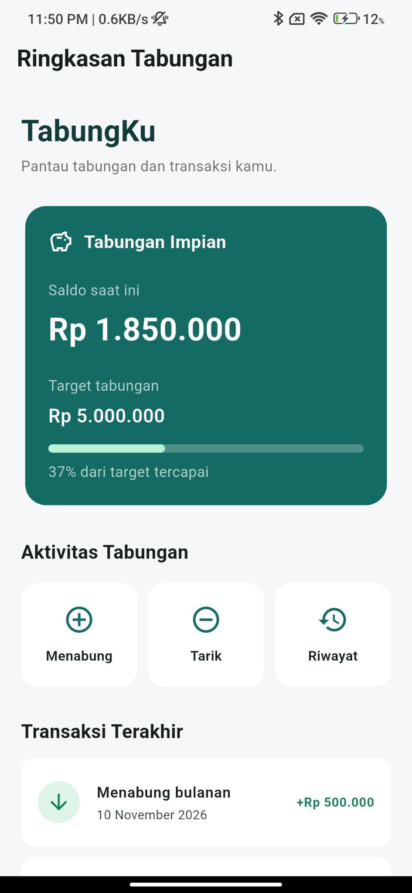
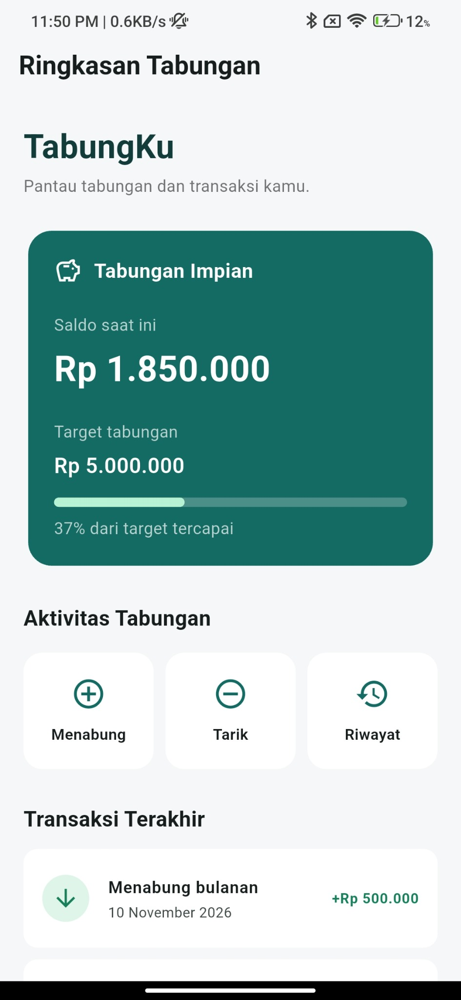

# TabungKu - Tugas Praktikum 3

**Nama:** Muhammad Naufal Febrian  
**NIM:** 20240801068  
**Mata Kuliah:** Pemrograman Mobile

## Deskripsi Aplikasi

TabungKu adalah aplikasi sederhana berbasis Flutter yang dibuat untuk menampilkan ringkasan tabungan. Aplikasi ini dikembangkan sebagai Tugas Praktikum 3 Pemrograman Mobile dengan menerapkan widget dasar Flutter yang dipelajari pada pertemuan sebelumnya.

## Fitur Aplikasi

- Menampilkan nama dan saldo tabungan.
- Menampilkan target tabungan beserta persentase pencapaiannya.
- Menampilkan tiga kategori aktivitas, yaitu Menabung, Tarik, dan Riwayat.
- Menampilkan daftar transaksi dengan judul, tanggal, dan nominal.
- Mendukung tampilan portrait dan landscape.

## Widget yang Digunakan

Aplikasi menggunakan beberapa widget dasar Flutter, seperti `MaterialApp`, `Scaffold`, `AppBar`, `Container`, `Padding`, `Row`, `Column`, `Expanded`, `SizedBox`, `Card`, `ListTile`, `ListView`, dan `LayoutBuilder`.

## Dokumentasi Tampilan

### Tampilan Portrait



### Tampilan Landscape



## Cara Menjalankan Aplikasi

1. Pastikan Flutter SDK sudah terpasang.
2. Clone repository:

   ```bash
   git clone https://github.com/PallFebrian/PemMob.git
   ```

3. Masuk ke folder proyek:

   ```bash
   cd PemMob/TP3/tabungku_layout
   ```

4. Jalankan perintah:

   ```bash
   flutter pub get
   flutter run
   ```

## Catatan

Aplikasi menggunakan data transaksi statis dan belum terhubung dengan database. Menu Menabung, Tarik, dan Riwayat masih berupa tampilan kategori sesuai kebutuhan tugas praktikum.